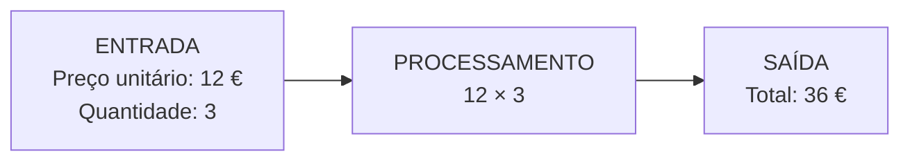

# Aula 001 — Programas, algoritmos e resultados

> **Fase 1 · Fundamentos da programação e da web**  
> **Módulo 1 · Pensamento computacional e resolução de problemas**  
> **Nível:** iniciante absoluto · **Duração:** 180 minutos · **Pré-requisitos:** nenhum  
> **Tecnologia prática:** JavaScript no console do navegador · **Materiais:** navegador atualizado, papel ou editor de texto

## Como estudar esta aula

Esta é uma aula de formação, não uma leitura rápida. Faça as previsões antes de executar o código, anote dúvidas e não avance apenas porque o exemplo funcionou. O objetivo é aprender a transformar uma necessidade em instruções precisas, justificar cada etapa e verificar se o resultado resolve o problema certo.

### Roteiro sugerido — 3 horas

| Etapa | Tempo | O que fazer |
| --- | ---: | --- |
| Contexto e objetivos | 10 min | Entender o problema que será resolvido |
| Teoria e representações | 40 min | Estudar algoritmo, programa, dados e precisão |
| Vídeo complementar | 25 min | Assistir aos trechos indicados e registrar ideias |
| Demonstrações guiadas | 35 min | Acompanhar decomposição, pseudocódigo e JavaScript |
| Pausa | 10 min | Descansar e retomar com atenção |
| Prática e debugging | 35 min | Executar, prever, comparar e corrigir |
| Exercícios independentes | 20 min | Resolver sem copiar o exemplo |
| Desafio e revisão | 5 min | Registrar o que aprendeu e o que ainda precisa praticar |

Os tempos são uma referência flexível. Se precisar de mais tempo para compreender ou depurar, use-o. Aprender não é competir contra o cronômetro.

## Objetivos

Ao concluir a aula, você deverá conseguir:

- Explicar a diferença entre problema, algoritmo, programa e linguagem de programação.
- Identificar entrada, processamento e saída num problema simples.
- Escrever um algoritmo finito com passos claros e ordenados.
- Traduzir o algoritmo para pseudocódigo e JavaScript.
- Explicar parâmetros, argumentos e retorno de uma função.
- Prever resultados com teste de mesa e confirmar por execução.
- Diferenciar erro de sintaxe e erro de lógica.
- Justificar casos de teste e reconhecer limitações da solução.


## 1. Situação real: calcular uma compra sem improvisar
## Pré-requisitos

Nenhum conhecimento de programação é necessário. A aula começa do zero. Você precisará de um navegador atualizado e de um computador para executar JavaScript no Console. Se estiver num telemóvel, poderá estudar a teoria e resolver pseudocódigo, mas a execução prática é mais confortável num computador. Não instale ferramentas nesta etapa.


Imagine uma pequena papelaria que precisa calcular o valor de uma encomenda. Uma pessoa pede três cadernos. Cada caderno custa 12 euros. O atendente precisa informar o total antes de concluir a compra.

Uma resposta intuitiva seria “multiplique doze por três”. Mas, para transformar isso em um procedimento que outra pessoa ou um computador consiga executar, precisamos esclarecer:

- Quais dados serão fornecidos?
- O que cada dado representa?
- Qual operação transforma esses dados no resultado?
- Em que formato o resultado será apresentado?
- Como saberemos que a resposta está correta?
- O que acontece se a quantidade for zero ou se alguém informar um valor inadequado?

A programação começa antes de escrever código. Começa por compreender o problema e explicitar as regras. Um programa pode executar perfeitamente uma instrução que não corresponde ao que foi pedido. Por isso, funcionamento técnico e correção da solução são coisas diferentes.

**Objetivo observável:** ao final desta aula, você deverá conseguir explicar o problema em linguagem simples, separar entrada, processamento e saída, escrever passos finitos, implementar uma função simples e testar o resultado com casos diferentes.

## Explicação — o que é programar?

Programar é especificar instruções que um sistema computacional pode executar para realizar uma tarefa. Essas instruções precisam ser representadas numa linguagem com regras próprias. O computador não completa intenções que ficaram apenas na cabeça de quem programou.

Considere a instrução humana “calcule a compra”. Ela é compreensível num contexto cotidiano, mas é insuficiente para uma máquina: qual compra, com quais itens, que operação, quais regras para descontos e qual saída? Um programa exige que essas decisões sejam explicitadas.

### 2.1 Hardware, software e sistema operacional

**Hardware** é a parte física do equipamento: processador, memória, armazenamento, teclado, ecrã e outros dispositivos. **Software** é o conjunto de programas e dados que orienta o equipamento. O sistema operacional, como Windows, macOS ou Linux, administra recursos e oferece serviços para outros programas.

Um navegador é software. Além de apresentar páginas, ele pode executar JavaScript. Nesta formação usaremos JavaScript para transformar os algoritmos em programas reais. O navegador será nosso primeiro ambiente de experimentação, sem exigir instalação de ferramentas nesta aula.

Não é necessário conhecer a arquitetura interna do processador para aprender a escrever um algoritmo. É importante, porém, compreender que o computador executa instruções de acordo com regras definidas, e não por adivinhar o que o autor pretendia.

### 2.2 Algoritmo, programa e linguagem

Um **algoritmo** é uma sequência finita, ordenada e suficientemente precisa de passos para resolver um problema ou realizar uma tarefa. Pode ser descrito em português, por pseudocódigo, por um fluxograma ou por código.

Um **programa** é uma implementação de instruções numa linguagem de programação, preparada para ser executada por um ambiente computacional. Um algoritmo pode ser implementado em linguagens diferentes, desde que as implementações preservem a regra pretendida.

Uma **linguagem de programação** define sintaxe e significado para expressar instruções. JavaScript e Python, por exemplo, têm sintaxes diferentes. Aprender uma linguagem é importante, mas aprender a analisar problemas e construir algoritmos é uma competência que atravessa linguagens.

| Termo | Pergunta que responde | Exemplo |
| --- | --- | --- |
| Problema | O que precisamos resolver? | Saber o total de uma encomenda |
| Algoritmo | Quais passos resolvem o problema? | Receber preço e quantidade; multiplicar |
| Linguagem | Como expressamos esses passos? | JavaScript |
| Programa | Qual implementação pode ser executada? | Uma função JavaScript |

Não confunda algoritmo com código. O código é uma forma de representar e executar a solução; o raciocínio que define a solução deve existir antes e continuar sendo avaliado depois.

## 3. Decompor o problema: entrada, processamento e saída
## Conceitos e diagrama


Uma técnica inicial muito útil é separar o problema em três partes:

1. **Entrada:** dados de que a solução precisa.
2. **Processamento:** operações e decisões aplicadas aos dados.
3. **Saída:** resultado produzido e comunicado.

No exemplo da papelaria, o preço unitário e a quantidade são entradas. A multiplicação é o processamento. O total calculado é a saída.



O diagrama é uma representação simplificada. Ele não mostra todas as validações que um sistema comercial real precisaria fazer, como moeda, arredondamento, disponibilidade, descontos ou impostos. Nesta aula isolamos um problema pequeno para estudar a estrutura da solução.

### 3.1 Dados não são resultados

Preço e quantidade não são o total. São dados usados para produzir o total. Essa distinção parece simples, mas ajuda a evitar erros de modelagem.

Se alguém informar preço 12 e quantidade 3, o processamento produz 36. Se a quantidade mudar para 4, o algoritmo continua o mesmo, mas a saída passa a ser 48. Uma boa solução separa a regra dos valores específicos usados em cada execução.

### 3.2 Uma instrução precisa deve ser verificável

Compare estas instruções:

- Vaga: “calcule o valor”.
- Mais precisa: “multiplique o preço unitário pela quantidade”.
- Verificável: “para preço unitário 12 e quantidade 3, devolva 36”.

Uma instrução verificável permite que outra pessoa confira o resultado sem precisar adivinhar o que o autor quis dizer. Ao escrever algoritmos, prefira ações observáveis: receber, comparar, somar, multiplicar, apresentar, guardar.

## 4. Construir o algoritmo antes do código

Antes de programar, escreva os passos em linguagem natural:

1. Receber o preço unitário.
2. Receber a quantidade de unidades.
3. Multiplicar o preço pela quantidade.
4. Apresentar o total.

Essa descrição já é um algoritmo simples. No entanto, palavras como “receber” e “apresentar” dependem do ambiente: numa aplicação, os dados podem vir de um formulário; num programa de terminal, podem vir do teclado; num serviço, podem vir de outra aplicação. O algoritmo descreve a lógica, enquanto a implementação define os mecanismos concretos.

### 4.1 Pseudocódigo

Pseudocódigo é uma forma estruturada de descrever passos sem seguir rigorosamente a sintaxe de uma linguagem específica. Não existe uma única sintaxe universal de pseudocódigo; a prioridade é a clareza.

```text
INÍCIO
  receber preço_unitário
  receber quantidade
  total ← preço_unitário × quantidade
  apresentar total
FIM
```

A seta representa atribuição: o resultado da operação passa a ser associado ao nome `total`. Ainda não estamos a escrever JavaScript. O pseudocódigo permite avaliar a sequência e a intenção sem nos distrair com detalhes da linguagem.

### 4.2 A ordem dos passos importa

Não podemos calcular o total antes de conhecer os valores necessários. Uma sequência que tente usar `quantidade` antes de recebê-la está incompleta. A ordem também pode mudar o resultado quando operações dependem umas das outras.

Um algoritmo deve ter começo e fim definidos, passos claros e uma condição de término. Um procedimento que repete instruções sem nunca chegar a uma condição de parada pode não terminar. Estruturas de repetição serão estudadas mais adiante; por enquanto, observe que “finito” significa que a execução deve conseguir chegar ao fim para as entradas previstas.

## Exemplo executável — da solução ao JavaScript

Agora vamos implementar o cálculo. Abra uma aba normal do navegador, abra as ferramentas de desenvolvimento (normalmente F12 ou pelo menu do navegador) e selecione **Console**. A interface pode variar conforme o navegador e o sistema operacional.

Digite o código abaixo. Não cole comandos desconhecidos em páginas onde tenha contas abertas. Não é necessário desativar proteções de colagem do navegador.

```javascript
function totalCompra(preco, quantidade) {
  return preco * quantidade;
}
```

A definição da função não calcula uma compra imediatamente. Ela registra uma função chamada `totalCompra`, que poderá ser chamada com valores diferentes.

Execute depois:

```javascript
totalCompra(12, 3)
```

Resultado esperado:

```text
36
```

Experimente também `totalCompra(5, 4)`. O resultado esperado é `20`. Antes de pressionar Enter, faça a previsão e explique por que espera esse valor.

## Explicação do código — lendo cada parte

- `function` inicia a definição de uma função.
- `totalCompra` é o nome escolhido. Um nome claro comunica a finalidade.
- `preco` e `quantidade` são parâmetros: nomes que recebem valores quando a função é chamada.
- As chavetas delimitam o corpo da função.
- `return` devolve o resultado ao ponto em que a função foi chamada.
- `*` é o operador de multiplicação.

Na chamada `totalCompra(12, 3)`, os argumentos são 12 e 3. O primeiro é associado ao parâmetro `preco`; o segundo, a `quantidade`. A função calcula 12 × 3 e devolve 36.

**Parâmetro** é o nome declarado na definição. **Argumento** é o valor concreto fornecido na chamada. Essa distinção será importante ao criar funções maiores.

### 5.2 O que a função ainda não faz

Este exemplo é intencionalmente pequeno. Ele não verifica se os valores são números, se são finitos, se o preço é negativo, se a quantidade é inteira ou se a moeda tem regras específicas de arredondamento. Também não apresenta uma interface, não guarda a encomenda e não comunica com um banco de dados.

Isso não torna o exemplo inútil. Ele ensina uma operação isolada. Em software real, os requisitos determinam as validações necessárias. Não acrescente regras por suposição; primeiro identifique o que o problema exige. A validação de condições será desenvolvida na Aula 003.

## Exercício guiado — acompanhar a execução com teste de mesa

Teste de mesa é acompanhar manualmente os valores e as operações de um algoritmo para prever o resultado. É uma maneira simples de descobrir falhas de raciocínio antes ou durante a execução.

Para `totalCompra(12, 3)`:

| Passo | Ação | Valor observado |
| --- | --- | --- |
| 1 | Associar primeiro argumento a `preco` | 12 |
| 2 | Associar segundo argumento a `quantidade` | 3 |
| 3 | Calcular `preco * quantidade` | 36 |
| 4 | Devolver o resultado | 36 |

Agora acompanhe três chamadas:

| Preço | Quantidade | Cálculo | Saída esperada |
| ---: | ---: | --- | ---: |
| 12 | 3 | 12 × 3 | 36 |
| 5 | 4 | 5 × 4 | 20 |
| 4 | 0 | 4 × 0 | 0 |

O último caso é útil porque testa uma situação que pode ser esquecida. Quantidade zero produz total zero nesta regra simplificada. O computador não sabe se uma encomenda com zero itens deve ser permitida; isso é uma decisão de requisito do sistema.

### 6.1 Prever, executar e comparar

Adote este ciclo:

1. Leia o problema e identifique as entradas.
2. Calcule manualmente um resultado esperado.
3. Execute o programa com os mesmos dados.
4. Compare a saída observada com a esperada.
5. Se forem diferentes, investigue a causa antes de alterar o código.

Não mude várias partes ao mesmo tempo. Se fizer várias alterações, ficará mais difícil descobrir qual delas provocou a diferença.

## 7. Debugging: quando o programa executa, mas resolve o problema errado

Um bug não é necessariamente uma mensagem vermelha no console. Há erros de sintaxe, erros durante a execução e erros de lógica. Nesta aula, o exemplo mais importante é o erro de lógica: o programa executa, mas não cumpre o requisito.

### 7.1 Erro de lógica

Suponha que alguém escreva:

```javascript
function totalCompra(preco, quantidade) {
  return preco + quantidade;
}
```

A chamada `totalCompra(12, 3)` devolve 15. Não aparece necessariamente uma mensagem de erro. Porém, o requisito era multiplicar preço pela quantidade. O resultado correto é 36.

**Diagnóstico:** compare o operador usado no código com a operação descrita no requisito. O problema não está na execução do JavaScript; está na tradução da regra para código.

**Correção:** use `*` em vez de `+`. Depois repita os casos de teste, não apenas o primeiro.

### 7.2 Erro de sintaxe

Experimente observar este exemplo incompleto:

```javascript
function totalCompra(preco, quantidade) {
  return preco * quantidade
```

A chaveta que fecha a função está ausente. O JavaScript não consegue interpretar a estrutura completa. O console apresenta uma mensagem de sintaxe, cuja redação pode variar entre navegadores.

**Como investigar:**

1. Leia a primeira mensagem de erro e identifique a linha indicada.
2. Verifique se parênteses e chavetas abertos foram fechados.
3. Compare a estrutura com a versão correta.
4. Corrija uma coisa de cada vez e execute novamente.

A mensagem pode apontar para o local onde o parser percebeu o problema, não necessariamente para o ponto exato em que você começou a cometê-lo.

### 7.3 Resultado inesperado não é prova automática de bug

Se o resultado for diferente do que você esperava, há pelo menos três possibilidades: o código está errado, a previsão manual está errada ou o requisito foi interpretado incorretamente. Volte ao enunciado, refaça a conta e só então decida o que corrigir.

<aside>
**Boa prática profissional:** registe entrada utilizada, resultado esperado, resultado observado e hipótese sobre a causa. Esse pequeno relatório torna a depuração mais objetiva e facilita pedir ajuda sem depender de “não funciona”.
</aside>

## 8. Demonstração interativa

Use o laboratório abaixo para alterar os valores e observar a saída. Antes de executar, tente prever o resultado. O ambiente é didático e isolado; não introduza dados pessoais nem código de terceiros.

````devpath
{
  "type": "playground",
  "mode": "javascript",
  "title": "Laboratório — calcular o total da compra",
  "code": "function totalCompra(preco, quantidade) {\n  return preco * quantidade;\n}\n\nconsole.log(totalCompra(12, 3));",
  "css": "",
  "expected": "36"
}
````

Depois de confirmar o resultado, altere os argumentos para `totalCompra(7, 6)`. Registe a previsão, execute e explique a diferença. Por fim, troque temporariamente `*` por `+` e descreva por que o programa continua executando, mas deixa de atender ao requisito.

## 9. Vídeo complementar

O vídeo abaixo é material externo, não produzido pela DevPath Academy. Foi escolhido como complemento em português por apresentar conceitos de lógica, algoritmos, pseudocódigo e exercícios. Não substitui as explicações e atividades desta aula. O curso completo é longo e aborda assuntos que pertencem a aulas futuras; assista apenas aos capítulos indicados.

````devpath
{
  "type": "video",
  "url": "https://www.youtube.com/watch?v=6OxA9er9VFo",
  "title": "Curso de Lógica de Programação e Algoritmos — Victor Lima",
  "description": "Material complementar externo. Para esta aula, concentre-se em 00:00–34:47: apresentação, programas, linguagens, lógica, algoritmos, pseudocódigo e primeiros exercícios. Os capítulos posteriores avançam para variáveis, condições e repetições, que serão estudadas noutras aulas. Ative as legendas se precisar e anote dúvidas; a disponibilidade e as legendas dependem do YouTube."
}
```

**Atividade durante o vídeo:** anote uma definição de algoritmo, um exemplo de instrução ambígua e uma diferença entre algoritmo e programa. Depois escreva essas ideias com suas próprias palavras, sem copiar a descrição do vídeo.

## Exercícios independentes — progressão por níveis

Resolva na ordem. Nos primeiros, explique o raciocínio em texto. Nos últimos, escreva pseudocódigo ou JavaScript. Não consulte uma solução pronta antes de tentar.

### Nível 1 — Compreensão

1. Explique a diferença entre problema, algoritmo, linguagem e programa usando o exemplo da papelaria.
2. Classifique preço, quantidade, multiplicação e total como entrada, processamento ou saída.
3. Explique por que “calcule corretamente” não é uma instrução suficientemente precisa.
4. Um algoritmo precisa ser escrito em JavaScript? Justifique.

### Nível 2 — Aplicação guiada

5. Uma loja vende quatro garrafas a 2,50 € cada. Identifique as entradas, descreva o processamento e indique a saída esperada.
6. Escreva os passos em pseudocódigo para calcular o preço de cinco bilhetes com o mesmo valor unitário.
7. Faça um teste de mesa para preço 8 e quantidade 4. Mostre cada etapa.

### Nível 3 — Aplicação independente

8. Uma pessoa quer calcular o perímetro de um retângulo. Recebe largura e altura. Escreva o algoritmo, identifique entradas e saída e justifique a fórmula.
9. Uma biblioteca empresta três livros. Cada livro tem um prazo de 14 dias. Descreva um algoritmo que calcule o total de dias de empréstimo, assumindo que os prazos são somados. Explique a hipótese.
10. Escreva uma função JavaScript chamada `calcularPerimetro` que receba largura e altura e devolva o perímetro. Teste com largura 5 e altura 3. Resultado esperado: 16.

### Nível 4 — Análise e debugging

11. Um colega implementou `preco - quantidade` para calcular o total de uma compra. O código executa. Identifique o tipo de erro, compare com o requisito e proponha uma correção.
12. Uma função recebe preço e quantidade, mas tenta multiplicar antes de receber os valores. Explique o problema de ordem no algoritmo.
13. O programa devolve 36 para a entrada 12 e 3. Isso prova que funciona para todas as compras? Explique por que um único caso não é suficiente.
14. Crie três casos de teste para a função de compra, incluindo uma quantidade zero. Escreva resultados esperados antes de executar.

## 11. Desafio prático — orçamento de material escolar
## Desafio prático


Uma papelaria quer calcular uma encomenda com dois produtos diferentes. O programa deve receber o preço unitário e a quantidade de cada produto, calcular os dois subtotais e somá-los para apresentar o total.

**Requisitos:**

- Identificar claramente os quatro dados de entrada.
- Calcular cada subtotal separadamente.
- Somar os subtotais para obter o total geral.
- Não misturar preço unitário com subtotal.
- Mostrar um resultado que outra pessoa consiga conferir.
- Criar pelo menos quatro casos de teste, incluindo uma quantidade zero.
- Escrever uma explicação curta da lógica e das hipóteses adotadas.

**Entrega:** descrição do problema, algoritmo em pseudocódigo, implementação JavaScript, tabela de testes e uma nota sobre limitações. Não acrescente descontos, impostos ou validações não solicitadas sem explicar que são hipóteses adicionais.

**Critérios de avaliação (100 pontos):**

| Critério | Pontos |
| --- | ---: |
| Entradas identificadas e nomeadas corretamente | 15 |
| Sequência lógica clara e completa | 20 |
| Cálculo dos dois subtotais | 20 |
| Cálculo do total geral | 15 |
| Casos de teste e resultados esperados | 20 |
| Clareza, organização e explicação das hipóteses | 10 |

Uma solução que apresenta o número correto por coincidência, mas não explica as etapas, não demonstra domínio do algoritmo.

## 12. Boas práticas para levar às próximas aulas
## Erros comuns e boas práticas


- Entenda o requisito antes de escolher operadores ou escrever funções.
- Use nomes que expressem o significado dos dados.
- Separe entradas, processamento e saídas.
- Prefira passos pequenos e verificáveis.
- Faça previsões antes de executar.
- Teste mais de uma entrada, incluindo casos-limite relevantes.
- Diferencie erro de sintaxe, erro de execução e erro de lógica.
- Não confunda “o programa executou” com “o programa resolveu o problema”.
- Registe hipóteses e limitações; não esconda decisões importantes dentro do código.

## Verificação de aprendizagem — revisão e avaliação final

Sem consultar o texto, responda:

1. O que é um algoritmo e por que seus passos precisam ser precisos?
2. Qual é a diferença entre algoritmo e programa?
3. Quais são as três partes do modelo entrada–processamento–saída?
4. O que são parâmetros e argumentos na função apresentada?
5. Por que um programa pode executar sem erro e ainda estar incorreto?
6. Como o teste de mesa ajuda a investigar resultados?
7. Que evidências você apresentaria para demonstrar que sua solução atende ao requisito?

**Autoavaliação:** considere esta aula concluída quando conseguir explicar os conceitos com suas palavras, decompor um problema novo, escrever passos finitos, implementar a função sem copiar e justificar pelo menos três testes. Se ainda não consegue, retome a seção correspondente e refaça os exercícios.

## Resumo

Programar começa por compreender um problema e transformar seus requisitos em passos precisos. Um algoritmo descreve uma sequência finita de ações; um programa implementa essas ações numa linguagem executável. Separar entrada, processamento e saída ajuda a organizar a solução. O pseudocódigo permite planejar sem depender da sintaxe de uma linguagem. Em JavaScript, uma função recebe argumentos por meio de parâmetros e pode devolver um resultado com `return`. O teste de mesa permite prever e acompanhar valores. Um programa pode executar sem erro e ainda conter um erro de lógica; por isso, é necessário comparar resultados observados com resultados esperados em diferentes casos.

## 14. Glossário essencial

- **Algoritmo:** sequência finita e precisa de passos para resolver uma tarefa.
- **Argumento:** valor concreto fornecido numa chamada de função.
- **Entrada:** dado recebido pela solução.
- **Função:** bloco de código reutilizável que pode receber valores e devolver um resultado.
- **Hardware:** componentes físicos do sistema computacional.
- **Parâmetro:** nome declarado na função para receber um argumento.
- **Processamento:** operações aplicadas aos dados.
- **Programa:** implementação de instruções numa linguagem executável pelo ambiente.
- **Pseudocódigo:** representação estruturada de um algoritmo sem exigir a sintaxe exata de uma linguagem.
- **Saída:** resultado produzido pela solução.
- **Software:** programas e dados usados pelo sistema computacional.
- **Teste de mesa:** acompanhamento manual dos passos e valores de um algoritmo.

## Referências e revisão — continuidade

- [MDN — Introdução a JavaScript](https://developer.mozilla.org/pt-PT/docs/Web/JavaScript/Guide/Introduction)
- [MDN — Funções](https://developer.mozilla.org/pt-PT/docs/Web/JavaScript/Guide/Functions)
- [MDN — Console do navegador](https://developer.mozilla.org/pt-PT/docs/Web/API/console)
- [Vídeo complementar — Victor Lima](https://www.youtube.com/watch?v=6OxA9er9VFo)

**Próxima aula:** Dados, variáveis e cálculos. Você aprenderá a representar números, textos e valores lógicos, escolher entre `const` e `let`, realizar operações e compreender por que dados de texto não são automaticamente números.
